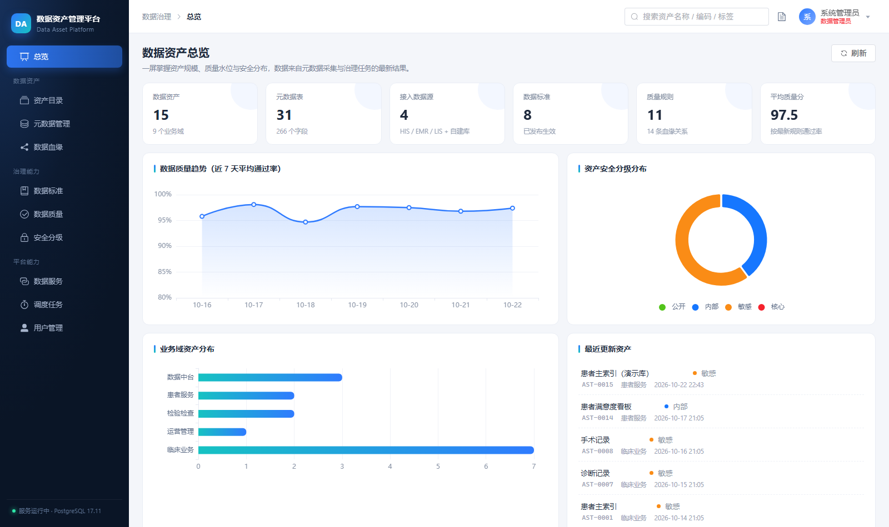

# 数据资产管理平台

覆盖元数据管理、资产目录、数据血缘、数据标准、数据质量、安全分级六大模块的可演示数据治理平台。

技术栈：**Spring Boot 3.5.16（Java 21）+ PostgreSQL 17 + JdbcTemplate + Vue 3 + Vite + Element Plus + ECharts**

演示场景为一家三甲医院的数据资产：HIS / EMR / LIS 三个业务库 + 平台自建库（真实可采集）。



## 目录结构

```
data-asset-platform/
├── backend/                 # Spring Boot 后端（8080）
│   ├── src/main/java/com/dataasset/platform/
│   │   ├── web/             # 8 个 Controller（REST API）
│   │   ├── service/         # 元数据 JDBC 采集、质量规则执行
│   │   └── bootstrap/       # 演示数据初始化（仅首次）
│   └── src/main/resources/
│       ├── application.yml
│       └── schema.sql       # 14 张表，幂等建表
├── frontend/                # Vue 3 前端（5173，/api 代理到 8080）
├── start-db.bat             # 启动 PostgreSQL
├── start-backend.bat        # 启动后端
├── start-frontend.bat       # 启动前端
└── stop-db.bat              # 停止 PostgreSQL
```

## 启动步骤（三个窗口，或依次双击 bat）

1. **数据库**：双击 `start-db.bat`（首次已初始化，账号 `asset / asset123`，库名 `asset_platform`）
2. **后端**：双击 `start-backend.bat`，等日志出现 `Started DataAssetApplication`
3. **前端**：双击 `start-frontend.bat`，浏览器打开 <http://127.0.0.1:5173>

接口文档：<http://localhost:8080/swagger-ui/index.html>

## 六大模块说明

| 模块 | 能力 | 亮点 |
|---|---|---|
| 元数据管理 | 数据源接入、JDBC 采集表/字段/主键/行数/注释、表结构查看、一键登记为资产 | 「资产平台自建库」可真实同步，验证整条链路 |
| 资产目录 | 业务域树、多维搜索、资产卡片、详情抽屉（字段/质量/权限/血缘四联） | 字段列表同时展示标准映射与脱敏策略 |
| 数据血缘 | 以资产为中心 1~3 层扩散、力导向图、表级+字段级、血缘明细维护 | 支持影响分析与问题溯源 |
| 数据标准 | 标准库（命名/编码/类型/枚举/度量）、字段映射、符合率统计 | 符合率环形图 + 标准覆盖 Top |
| 数据质量 | 非空/唯一/值域/枚举/正则/时效性规则、单条或全部执行、通过率趋势 | 本机数据源真实执行 SQL，远程演示库自动降级为模拟并在结果中标注 |
| 安全分级 | L1~L4 分级、字段级脱敏策略（掩码/部分隐藏/哈希）、授权角色、审计开关、脱敏引擎预览 | 敏感资产聚合视图；预览对本机数据源真实查询，原始值 vs 脱敏值对照 |

## 平台能力模块

### 登录与角色权限

- 内置账号：`admin / admin123`（数据管理员）、`steward / steward123`（数据管家）、`analyst / analyst123`（数据分析师）
- Token 鉴权（`Authorization: Bearer`，12 小时有效期），密码 SHA-256 加盐存储
- 接口级角色控制：`@RequireRole` 注解；菜单按角色过滤；用户管理页（仅管理员）支持增删改、重置密码、禁用

### 定时调度

- `sched_job` 配置 + Spring `TaskScheduler` 动态注册 CronTrigger，改 cron / 启停即时生效
- 内置任务：质量全量检查（每日 2:00）、元数据定时采集（每 30 分钟）、网关日志清理（默认停用）
- 支持立即执行、执行历史日志；页面「调度任务」

### 数据服务 API 网关

- API 即资产：绑定资产 + 命名参数 SELECT 模板 + 参数白名单（JSON 定义）
- 调用方式：`POST /openapi/v1/{apiCode}`，请求头 `X-App-Id` / `X-App-Key`（客户端密钥管理，可换 Key）
- 内置安全机制：仅允许单条 SELECT、未声明参数一律丢弃、每分钟限流、全部调用留痕（耗时/行数/脱敏列/错误）
- 页面「数据服务」：API 管理 / 客户端密钥 / 调用日志 / 在线调试（走网关同链路）

### 脱敏引擎（对接真实查询）

- `MaskingService` 四种策略：MASK（保留前 1/3）、PARTIAL（保留前 3 后 4）、HASH（SHA-256 前 12 位）、NULLIFY
- 按 `security_policy` 配置对**真实查询结果**逐列脱敏：网关出参、安全分级页脱敏预览均走同一引擎
- 演示真实表 `biz_patient`（80 行合法格式身份证/手机号）+ 演示资产 AST-0015「患者主索引（演示库）」


## 后端 API 一览（前缀 `/api`）

```
-- 认证（登录/登出免鉴权，其余全部需要 Bearer Token）
POST   /auth/login                      登录 → { token, user, permissions }
GET    /auth/me  POST /auth/logout      当前用户 / 登出
GET    /auth/users                      用户管理（仅 ADMIN）
CRUD   /datasources                     数据源管理
POST   /datasources/{id}/sync           采集元数据
POST   /datasources/{id}/test           测试连接
GET    /metadata/tables | /tables/{id}  表与字段
GET    /domains  /assets  /assets/{id}  业务域与资产
POST   /assets/from-table/{tableId}     元数据表 → 资产
GET    /lineage/graph?assetId=&depth=   血缘图（BFS 扩散）
CRUD   /standards  /standards/mappings  数据标准
GET    /standards/conformance           符合性统计
CRUD   /quality/rules                   质量规则
POST   /quality/rules/{id}/run          执行规则
GET    /quality/summary | /trend        质量统计
CRUD   /security/policies               脱敏策略
GET    /security/summary                分级统计
GET    /security/mask-preview           脱敏引擎预览（真实查询，原始 vs 脱敏）
GET    /scheduler/summary               调度任务列表
PUT    /scheduler/jobs/{id}             改 cron / 启停（ADMIN/STEWARD）
POST   /scheduler/jobs/{id}/run         立即执行
GET    /dataservice/apis | /clients | /logs   网关管理
POST   /dataservice/apis/{id}/debug     在线调试（走网关链路）

-- 对外网关（免登录，AppKey 鉴权）
POST   /openapi/v1/{apiCode}            请求头 X-App-Id / X-App-Key，出参自动脱敏
```

## 环境依赖（均已装在本机）

| 组件 | 位置 |
|---|---|
| JDK 21 | `D:\Program\JavaProgram\jdk-21` |
| Maven 3.9.16 | `D:\Program\JavaProgram\maven-3.9.16` |
| PostgreSQL 17.11 | `D:\Program\JavaProgram\pgsql-17.11`（数据目录 `pgdata`） |
| Node 22 + npm | 系统已装 |

## 常用运维命令

```bash
# 手动打包
cd backend && mvn -DskipTests package
java -jar target/asset-platform-1.0.0.jar

# 手动起前端
cd frontend && npm run dev

# 重置演示数据：停后端后
psql -U asset -d asset_platform -c "truncate asset, meta_table, meta_column, lineage_edge,
  data_standard, standard_mapping, quality_rule, quality_result, security_policy restart identity"
# 重启后端即重新初始化
```

## 已知边界

- 演示数据源（HIS/EMR/LIS）为虚构地址，质量规则对其输出模拟结果并在 `detail` 标注 `SIMULATED`；接入真实库后自动变为真实执行（`REAL`）
- 平台自建库采集的是平台自身的表（含演示表 `biz_patient`），属预期行为
- 网关仅允许本机数据源真实执行；SQL 模板仅限单条 SELECT，结果上限 100 行
- 登录 Token 存内存，重启后需重新登录；生产建议替换为 Redis + JWT
- 调度为进程内 TaskScheduler，多实例部署需换 XXL-Job / Quartz 等分布式调度
